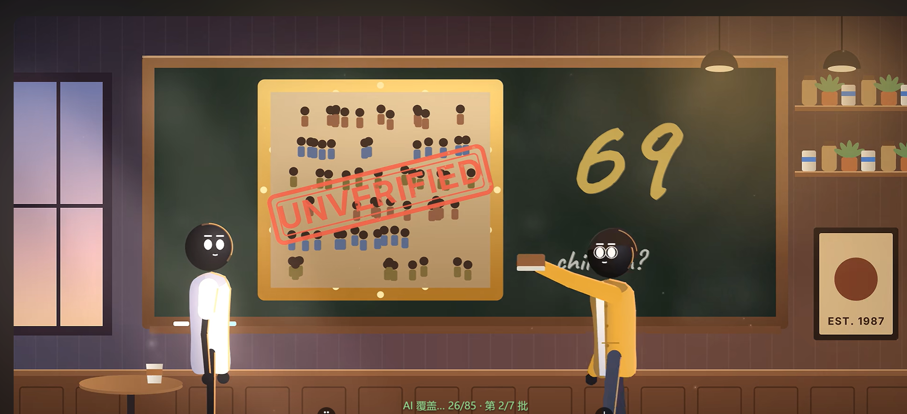

# YouTube 双语字幕翻译（复刻版）



> 实机效果：原文（绿）+ AI 译文（黄）双层自渲染字幕，右上角显示 AI 覆盖进度

> 仓库：<https://github.com/LainVs/youtube-translate-ext>（私有）

复刻“快捷翻译”一类 Chrome 扩展的 **YouTube 字幕翻译** 功能：
在 YouTube 播放器上叠加一层自己渲染的 **原文 + 译文双语字幕**，支持分别设置字体颜色、字号和整体缩放比例。

## 功能

- ✅ 预取全片字幕，双语显示（原文 / 译文各自可调颜色、字号、缩放）
- ✅ 时间轴精准同步（二分匹配当前字幕）
- ✅ 批量翻译 + 缓存，视频切换自动重载
- ✅ 可隐藏 YouTube 原生字幕
- ✅ 可拖拽调整字幕位置，位置自动保存
- ✅ 广告播放时自动隐藏字幕
- ✅ 翻译引擎：Google 免费端点（默认，无需 Key）/ AI 翻译（OpenAI 兼容接口）
- ✅ 导出字幕文件：SRT / VTT / TXT，内容可选 双语 / 仅译文 / 仅原文

## 安装（开发版）

1. 打开 Chrome，地址栏输入 `chrome://extensions/`
2. 右上角打开「开发者模式」
3. 点「加载已解压的扩展程序」，选择本项目根目录（含 `manifest.json` 的那一层）
4. 打开任意有字幕的 YouTube 视频即可看到效果

> 视频必须有 CC 字幕轨道（“CC”按钮高亮）。没有字幕的视频无法翻译。

## 使用

1. 点击工具栏扩展图标打开设置面板
2. 选择目标语言、翻译引擎、字幕样式（颜色 / 字号 / 缩放）
3. 回到视频页，字幕会自动出现
4. 若“没反应”：点扩展图标 →「诊断」→ 分别用 **测试翻译** 和 **检查当前页字幕状态**
   看是字幕没取到还是翻译失败（页面上也会弹出提示条说明原因）

## 工作原理

```
① 挂上钩子（main-fetch.js，world: MAIN + document_start）
   劫持 XMLHttpRequest / fetch，把播放器自己发的 /api/timedtext
   响应正文缓存下来 →  这条路用页面自己的合法身份（真 cookies + PoToken），
   永远不会 403，也不需要伪装客户端
② 取字幕正文   优先重放 ANDROID 轨道的 baseUrl（毫秒级，可重复取）
              失败则调 setOption 逼播放器重新拉一次字幕，从钩子里取响应
③ 取字幕轨道   innertube /youtubei/v1/player 多客户端链：
              ANDROID → ANDROID_VR → IOS → WEB（照抄页面自己的
              clientVersion + visitorData）
              全挂则读player.getOption("captions","tracklist")（零网络）
④ 翻译         content.js 批量发给 background.js
              → Google 免费端点 / AI 接口 → 结果写缓存
⑤ 渲染         player 内注入 #ytbs-wrapper 双语字幕层
⑥ 同步         setInterval(100ms) 读取 video.currentTime，二分查找当前字幕
```

> ⚠️ **三个踩过的坑（都有实测依据）**
> 1. **PoToken URL 是一次性的。** 页面 `ytInitialPlayerResponse` 里那份
>    `captionTracks[].baseUrl` 带 `&exp=xpe` 但**没有** `pot` 参数，
>    播放器实际请求用的那份**有** `pot=…`。实测：
>    播放器自己请求 → `200` / `46010` 字节 / `286 events`；
>    拿同一个 URL 重放 → `200` / **`0` 字节**。
>    所以只能**截获**，绝不能**重放**。
> 2. **innertube 在登录状态下很容易吃 403。** ANDROID 客户端伪装 + 已登录的
>    桌面 cookie 会被 Google 反滥用系统判为机器人，返回
>    `HTTP 403` + `<title>Sorry...</title>` 页面（静默失败，不报错）。
>    实测同一台机器：**未登录会话 8/8 全 200，登录会话必 403**。
>    →所以轨道获取必须有多客户端链 + 零网络的播放器兜底，正文必须走钩子。
> 3. **字幕请求必须发在页面主世界。** 从 service worker 或隔离世界发出时，
>    请求带 `Origin: chrome-extension://…`，同样回 403。所以用
>    `world: "MAIN"` 的 content script（`src/main-fetch.js`）
>    配合 `postMessage` 与主 content script 通信。

详细调研见 [`research/FINDINGS.md`](research/FINDINGS.md)。

## DOM 实时兜底（⑦）

上面①~⑥是**预取全片字幕**——需要完整时间轴，所以必须拿到字幕 API 的响应。
若①②③全部失败，自动降级为 `content.js` 里的 **DOM 实时模式**：

```
MutationObserver 监听 #movie_player
  → 读 .ytp-caption-segment 里 YouTube 自己画好的字幕
  → 攒 400ms 一批送去翻译 → 叠加到自绘覆盖层
```

这正是「快捷翻译」那类成熟插件的做法：**完全不碰 `timedtext` 接口**，
因此不受 PoToken / 403 影响，只要原生 CC 开着就一定有字幕。

| | 预取模式（主） | DOM 实时模式（兜底） |
|---|---|---|
| 依赖 | 字幕 API 响应 | 仅原生 CC |
| 时间轴 | 全片完整 | 只记已看到的部分 |
| 导出 SRT | 完整 | 不完整 |
| 抗风控 | 脆弱 | **很强** |
| 首屏延迟 | 需等批量翻译 | 近乎实时（约 0.4s 攒批） |

## 目录结构

```
youtube-translate-ext/
├── manifest.json              # MV3 配置
├── src/
│   ├── main-fetch.js          # world: MAIN，挂钩子 + innertube 多客户端链
│   ├── content.js             # 取字幕 + 渲染 + 同步 + 导出 + DOM 实时兜底（核心）
│   ├── content.css            # 字幕层样式
│   ├── background.js          # 翻译请求（Google / AI）
│   ├── popup.html/js/css      # 设置面板 + 诊断
│   └── icons/                 # 扩展图标
├── bridge/                    # OpenCode → OpenAI 兼容 桥接服务
├── preview/ui-preview.html    # UI 预览
├── scripts/generate-icons.ps1 # 图标生成脚本
└── research/                  # 竞品调研 + 参考源码
```

## 翻译引擎说明

- **Google 免费端点**：`translate.googleapis.com/translate_a/single`，无需 Key，开箱可用。
- **AI 翻译**：任何 OpenAI 兼容的 `/chat/completions` 接口。填写 Base URL、API Key、模型即可，
  也可以指向本地的 opencode / 自建网关，例如 `http://localhost:xxxx/v1`。
  AI 翻译更懂上下文、更口语化，但需要自备 Key。
- **接入 OpenCode**：OpenCode 原生 API 是会话式的，不兼容 `/chat/completions`。
  本项目在 [`bridge/`](bridge/) 提供了一个零依赖的桥接服务，内部调用本机 OpenCode CLI
  （`opencode run --format json`）并包装成 OpenAI 格式。**注意**：OpenCode 免费模型（含
  `opencode/big-pickle`）在 HTTP `POST /api/experimental/generate` 上会被拒
  （"free tier can only be used from within OpenCode"），但命令行 `opencode run` 属于内部调用，可用。
  详见 [bridge/README.md](bridge/README.md)。AI 引擎的默认配置即为
  `http://localhost:8788/v1` + `agent2/auto`（智能模式：模型前缀 `agent2/` 走本机
  Agent2API 网关，按优先级逐个试，哪个能用用哪个；失败自动冷却换下一个）。

## 持久化翻译缓存

- 翻译结果按「视频 + 引擎 + 目标语言」缓存在 `chrome.storage.local`。
- 同一视频再次打开时直接命中缓存，无需重新翻译。

## 已知限制 / 后续可做

- 字幕获取走 ANDROID InnerTube 客户端（客户端版本 `20.10.38`，写在 `src/main-fetch.js` 里）。
  YouTube 若调整客户端版本或风控策略，可能需要更新该版本号；页面 `baseUrl` 直接取字幕已基本不可用。
- 字幕请求依赖 `world: "MAIN"` content script，需要 Chrome 111 及以上。
  如果 YouTube 日后加固到页面主世界也会被拦，就需要换成 BotGuard PoToken 方案（重量级）。
- 若取不到字幕/翻译失败，页面会出现提示条（否则是静默失败）。
- 目前字幕按“整条”翻译，超长视频首次翻译需要一点时间（有进度提示）。
- 后续可选：自动检测原字幕语言。
